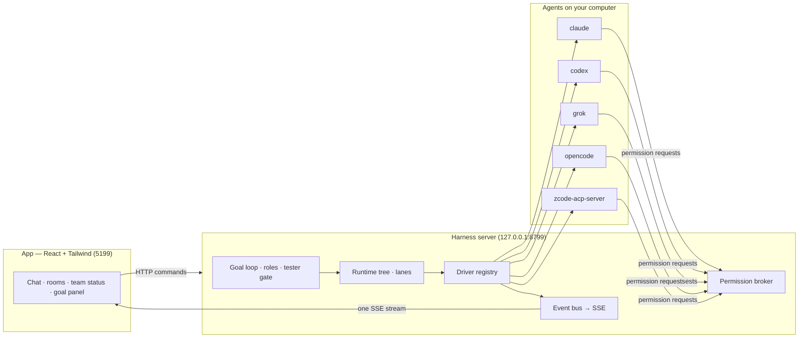

<div align="center">

# Bot Management

**A team of AI bots in one chat app, run as a real team: a Lead that plans, Workers that build in parallel, a Tester that signs off.**

Built on [OpenMausBot](https://github.com/milind-soni/OpenMausBot) · local-first · bring your own agents


</div>

---

## What this is

Every bot in the sidebar is a real agent (Claude, Codex, Grok, OpenCode, ZCode, or any ACP-speaking CLI) running on
your own machine, with its own model, folder, computer and connected apps. Put several bots in a **room** and they
work as a team on one goal.

This repository is a fork of OpenMausBot that focuses on **how that team works together**: who plans, who builds,
who checks, what happens when you interrupt, and how you see what everyone is doing.

## What's new in this fork

### Team workflow

| | |
|---|---|
| **Standing roles per room** | Give each member a role — **Lead**, **Worker**, **Tester** or **Reviewer** — from the room's *Team status*. The Lead coordinates every goal; it never takes a task itself. Roles live on the room, so one bot can be a Worker here and a Tester elsewhere. |
| **Parallel waves by default** | In a room of three or more, the Lead plans tasks with dependencies and declared writes; independent tasks run side by side, each in its own lane thread. Tasks that touch the same files run one after another. A *Parallel goal work* switch turns it off per room. |
| **Tester gate** | A plan with Worker tasks gets a Tester task that waits on them. The goal cannot complete until the Tester ends with `VERDICT: PASS`. A failure starts a fix round for the Worker who owns the file (at most three). |
| **Plan checks** | A plan that hands work to the Lead, to a member without a role, or to a Worker without listing what it writes goes back to the Lead to fix. |
| **Reviewers read only** | Review tasks run as consultations at the *Ask* level: any write or command waits for your approval. Hard-enforced with `OMB_ROLE_CEILING=1` (a consultation node's recorded level caps the turn and the app's auto-approvals); without the flag it relies on the model following its role. |
| **Out of AI usage** | A member whose model hits its usage limit or runs out of credits leaves the run; the Lead is told to hand its task to a free member of the same role. Bots with a backup AI configured keep going on it, as before. |

### Talking to a team that is working

| | |
|---|---|
| **Ask anyone, stop no one** | Mention a teammate while the room is busy (`@Clover is the API done?`) and it answers in a lane of its own. The running work and every other bot keep going. A teammate that is busy answers after its current step. Stop still ends the whole tree of work it started, by design. |
| **Progress at once** | A short question such as *"how is it going?"* or *"tình hình sao rồi"* while the room works is answered immediately by the app — goal turn, who is on what, for how long, latest step — without spending a bot turn. |
| **Work requests become goals** | In a room with a Lead, a message that asks for work (*"build the checkout page"*, *"fix the login bug"*) starts a goal automatically. Start a message with `/chat` to just talk, or `/goal` to force a goal. Switchable per room. |

### Seeing what is happening

- **Team status** in the room panel: each member's role, model, and live state — working, coordinating
  (turn n/13), waiting for you, idle or unavailable — plus the job it is running, how long it has run and its
  newest step.
- **Goal panel**: click a goal card to see the run's turn, the team, and every result since the goal started.
- Long bot replies in a room fold to their opening with **Show full**.

### Known limitations

- Declared `writes` only order the plan's waves; writes outside the declared set are not detected yet.
- PASS rests on the Tester's `VERDICT` line until verdicts are matched against executed-command evidence.
- The role permission ceiling needs `OMB_ROLE_CEILING=1`; without it, consult-at-Ask relies on the model.
- API keys are stored as plain text in `config.json` (inherited from upstream).
- A local machine has no filesystem sandbox: out-of-bounds writes are detected after the fact at best.
- Research results need provenance (manifest + validator) before their numbers can be trusted.
- The 13-turn goal limit pauses a run without a hand-off summary; sending the goal again restarts the count.

### Engines and fixes

- **ZCode** built-in engine through [`zcode-acp-server`](https://github.com/william0wang/zcode-acp): its models
  (`provider\model` ids) appear in the picker; on Windows the app finds the ZCode CLI and Node itself
  (`ZCODE_BIN` / `ZCODE_NODE` override them).
- **Grok** with a tool selection no longer refuses when `~/.grok/config.toml` contains arrays of tables such as
  `[[marketplace.sources]]`.

The design notes and the progress log are in [`docs/plans/team-workflow.md`](docs/plans/team-workflow.md) and
[`docs/plans/lead-layer-note.md`](docs/plans/lead-layer-note.md).

## Quick start

Requirements: **Node 24+**, **pnpm**, and at least one agent CLI installed and signed in (`claude`, `codex`,
`grok`, `opencode`, `zcode-acp-server`, …). Windows, macOS and Ubuntu 24.04 are supported.

```sh
git clone https://github.com/KhangTranManh/Bot_Management && cd Bot_Management
pnpm install

pnpm dev:server    # harness server → http://127.0.0.1:8799
pnpm dev           # app → http://127.0.0.1:5199
pnpm dev:desktop   # optional Electron shell; keep the two above running
```

Engines you have installed appear in the model picker automatically. Optional keys (Composio, Boat, voices)
go in **App Settings**; local chat works without them.

## Running a team

1. Create a room with your bots, open its panel (click the room name), and set roles in **Team status**:
   one Lead, one or more Workers, a Tester, optionally a Reviewer.
2. Send the work: *"build a shop page with cart and checkout"*. In a room with a Lead it runs as a goal; elsewhere,
   type `/goal` first.
3. Watch it in **Team status** or click the goal card. Ask anyone anything while it runs — nothing stops.
4. A goal ends when the Lead reports it complete after the Tester passes, when it needs you, when it is blocked,
   or at the 13-turn safety limit (a parallel batch counts as one turn). Send the goal again to continue.

| Setting | Where | Default |
|---|---|---|
| Roles | Room panel → Team status | none (goals run without role rules) |
| Run work requests as goals | Room panel | on once the room has a Lead |
| Parallel goal work | Room panel (rooms of 3+) | on |
| `OMB_LEAD_DEPT_CAP` | server environment | unset; `0` turns parallel waves off everywhere, `1` on for any room |

## How it works



| Layer | Where | What it does |
|---|---|---|
| Goal loop | `server/group-goal-run.ts`, `server/team-roles.ts`, `server/lead-schedule.ts` | Lead turns, plan checks, wave scheduling, Tester gate, fix rounds, usage-limit handover |
| Runtime tree | `server/runtime/`, `server/runtime-coordinator.ts` | Hand-offs between bots, lanes, queuing when a bot is busy, budgets, restart recovery |
| Rooms | `server/routes/channels.ts`, `server/room-now.ts` | Sends, side replies, progress answers, live team status (`GET /api/groups/:id/now`) |
| Drivers | `server/drivers/` | One per engine, normalised into one runtime event stream |
| App | `src/` | Chat shell, room panel, goal panel, composer commands |
| Desktop | `electron/` | macOS, Windows and Ubuntu shells with an embedded harness |

Other capabilities inherited from OpenMausBot — approval cards, cloud and local computers, connected apps,
voice and calls, triggers and webhooks, the MCP server and the `openmausbot` CLI — work as documented in
[`docs/`](docs/).

## Development

```sh
pnpm typecheck      # app + server
pnpm lint           # oxlint, warnings fail
pnpm test           # unit, driver, API, e2e and desktop tests
pnpm build          # typecheck + production build
```

Before claiming a server or conversation change works, follow
[`docs/verification/README.md`](docs/verification/README.md): verify against an isolated fixture, never your live
data. Code conventions are in [`AGENTS.md`](AGENTS.md).

Known test caveat on Windows: `shared/app-frame/helper.test.ts` is timing-sensitive and can fail intermittently;
it fails the same way on the upstream base.

## License and credits

[Apache License 2.0](LICENSE). Based on OpenMausBot © 2026 Milind Soni and OpenMausBot contributors; changes in
this fork © 2026 their authors. `enterprise/` is source-available under its [own license](enterprise/LICENSE).
See [LICENSING.md](LICENSING.md) and [NOTICE](NOTICE).

Packaged Cua Driver components keep their upstream licenses; notices and the SBOM are in
[`third_party/cua-driver/`](third_party/cua-driver/).

Not affiliated with xAI, Anthropic, OpenAI, Z.ai or the makers of any engine it runs; product names are trademarks
of their owners.
