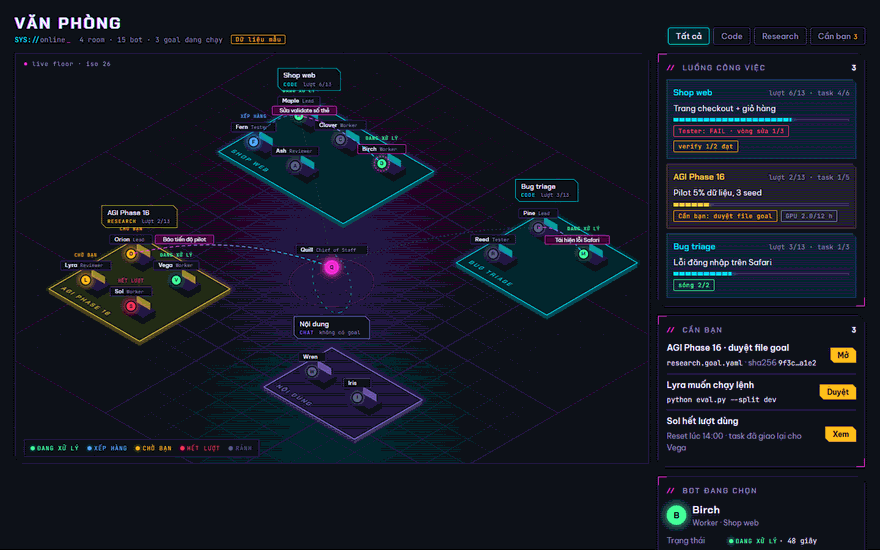

# Neon Office

The approved visual direction and screen definitions for Bot Management. This directory contains a design system
and an interactive HTML preview with sample data. The app now has a Neon skin, Compact layout and a frontend Office
using existing room APIs. Backend and database schemas are unchanged.

## Design sources

| Source | Purpose |
|---|---|
| [Office preview](office-preview.html) | Open locally in a browser to explore the scene and filters |
| [Brand book](project/README.md) | Copy, color, type, motion, layout and data rules |
| [Tokens](project/tokens.json) / [CSS tokens](project/tokens.css) | Design values and browser styles |
| [Components](project/components/) | Component definitions and individual HTML previews |
| [Screen definitions](../../NOTE.md) §10.5–10.6 | Approved decisions, behavior, data requirements and acceptance criteria |
| [Compact layout](compact-layout.md) | Desktop sizes, readable typography, touch targets and responsive acceptance criteria |

## Approved decisions

- Neon is the default dark skin; existing skins remain selectable. There is no light Neon variant.
- Office is a new sidebar entry alongside the room and bot list.
- Run metrics belong in the goal panel: role turns, input/output/cache, available cost data and unused-role warnings.
- Existing app screens keep their functionality while adopting the skin. The team surfaces gain the new components.

| Screen | Definition |
|---|---|
| S1 Sidebar | Office entry, attention count and room goal states |
| S2 Office | Room platforms, bot states, handoffs, goals, approvals, selected bot and activity |
| S3 Room panel / Team status | Roles, current work, quota/reset, approval links, room kind and verify settings |
| S4 Goal card / panel | Task plan, Tester/verify/metric results, run usage and activity |
| S5 Research settings | Goal-file validation, hash and approval, budget and metric history |
| S6 Skin picker | Neon default and retained existing skins |

## Implementation order

1. U0: skin and fonts (S6).
2. Server: goal-card task/check data and the planned endpoints `GET /api/office`,
   `GET /api/groups/:id/goal-runs/:runId/usage`, `GET /api/groups/:id/research`.
3. Room and research settings (S3 + S5).
4. Goal card and panel (S4).
5. Sidebar and Office (S1 + S2).

These endpoints remain future requirements, not published APIs. The frontend implementation uses the existing
snapshot, room `/now` and group PATCH routes instead; it does not add server routes or database migrations.
Detailed task plans, real handoff traces, research ledger charts and per-run/per-role usage remain deferred until
the existing API provides those data. The goal panel labels available usage as current-thread totals.

Room settings can edit kind and verify commands and approve a goal file through the existing API. Validation and
hash locking remain server-owned. The full screen definitions in NOTE.md §10.6 describe the target; §10.8 records
which parts are available under the frontend-only constraint.

## README animation

The repository README uses [neon-office.gif](../../docs/images/neon-office.gif): 880×550, 58 frames, 8.7 seconds,
approximately 358 KiB. It depicts this HTML preview with sample data, not a live app session. The preview labels its
sample data and supports reduced motion; the GIF is a recorded illustration.
